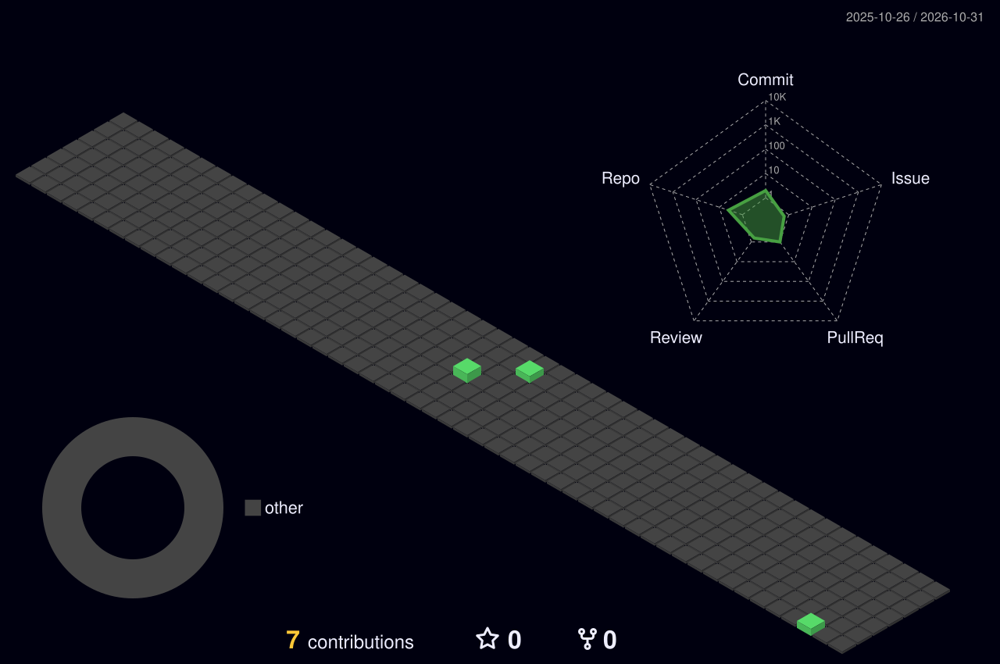

<div align="center">

<pre>
 ██████╗  ██████╗ ███╗   ██╗ ██████╗██╗  ██╗ █████╗ ██████╗  ██████╗ ██╗   ██╗
██╔════╝ ██╔═══██╗████╗  ██║██╔════╝██║  ██║██╔══██╗██╔══██╗██╔═══██╗██║   ██║
██║  ███╗██║   ██║██╔██╗ ██║██║     ███████║███████║██████╔╝██║   ██║██║   ██║
██║   ██║██║   ██║██║╚██╗██║██║     ██╔══██║██╔══██║██╔══██╗██║   ██║╚██╗ ██╔╝
╚██████╔╝╚██████╔╝██║ ╚████║╚██████╗██║  ██║██║  ██║██║  ██║╚██████╔╝ ╚████╔╝ 
 ╚═════╝  ╚═════╝ ╚═╝  ╚═══╝ ╚═════╝╚═╝  ╚═╝╚═╝  ╚═╝╚═╝  ╚═╝ ╚═════╝   ╚═╝  
</pre>

<a href="https://git.io/typing-svg"></a>

</div>

---

<div align="center">

<pre>goncharof@github:~$ cat about.ts</pre>

</div>

```ts
const goncharov = {
    name: "Ivan Goncharov",
    pronouns: ["he", "him"],
    location: "Setúbal, Portugal",
    currentWork: "Destination Guides @ FlightPath3D",
    focus: ["TypeScript", "maps & 3D globes", "interactive UIs"],
    learning: ["Go", "Rust"],
    contact: "ivango89@gmail.com",
} as const;
```

<div align="center">

[](mailto:ivango89@gmail.com)
[](https://www.linkedin.com/in/ivan-goncharov-2b305212a)

</div>

---

<div align="center">

<pre>goncharof@github:~$ ls tech-stack/</pre>

<p>
  <a href="https://skillicons.dev">
    
  </a>
</p>

</div>

---

<div align="center">

<pre>goncharof@github:~$ ps aux | grep now-building</pre>

</div>

```diff
+ 🌍  interactive 3D globes & maps for in-flight destination guides
+ 🎬  video subsystems and media playback in the browser
+ 🧱  type-safe store architecture & HTTP clients in TypeScript
+ ⚙️  CI pipelines that keep it all green
! 🦀  side quests: Go & Rust
```

---

<div align="center">

<pre>goncharof@github:~$ git log --graph --3d</pre>



<br/>

<picture>
  <source media="(prefers-color-scheme: dark)" srcset="./dist/snake-dark.svg" />
  <source media="(prefers-color-scheme: light)" srcset="./dist/snake.svg" />
  
</picture>

</div>

---

<div align="center">

<pre>goncharof@github:~$ fortune | cowsay</pre>


</div>

---

<div align="center">

<pre>goncharof@github:~$ echo $VISITORS</pre>


</div>
